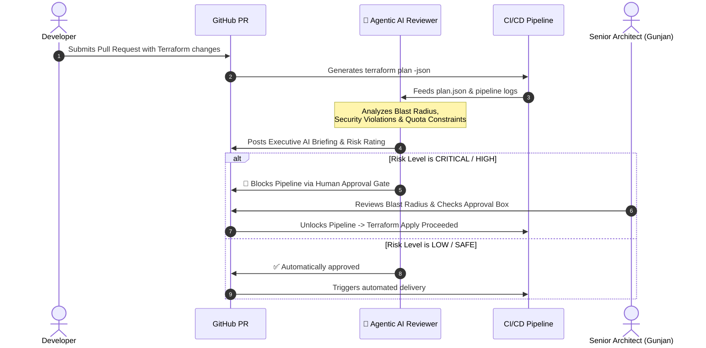

# 🤖 Agentic AI Terraform Reviewer & CI/CD Troubleshooter

[](https://python.org)
[](https://github.com/gunjankumargaurav7350/agentic-ai-terraform-reviewer)
[](https://github.com)
[](https://developer.hashicorp.com)

An autonomous **Agentic AI platform** engineered to safeguard production cloud environments. Authored by **Gunjan Kumar Gaurav** (Senior Cloud & DevSecOps Consultant).

> 💡 **Why This Project Stands Out:**  
> While traditional linters only look at syntax, **Agentic AI Terraform Reviewer** assesses true **infrastructure blast radius**, detects high-risk operational traps (destructive database/storage drops, `0.0.0.0/0` internet exposures), diagnoses obscure CI/CD failures, and enforces mandatory **Human-in-the-Loop Approval Gates** before applying changes to production.

---

## 🏛️ Autonomous Agentic Workflow



---

## ⚡ Core Capabilities

### 1. Blast Radius & Danger Detection
- **Destructive Deletion Sentinel:** Detects any state delta destroying databases, storage accounts, or virtual networks.
- **Insecure Open Ports:** Catches security rules opening sensitive ports (`22`, `3389`, `1433`) to `0.0.0.0/0`.
- **Automated Risk Scoring (0–100):** Classifies plans into **LOW**, **MEDIUM**, **HIGH**, and **CRITICAL** tiers.

### 2. CI/CD Failure Troubleshooter
- Parses stderr output from Azure DevOps / GitHub Actions runs.
- Identifies regional core quota exhaustion, circular graph dependencies, and Azure storage lease locks.
- Outputs copy-paste remediation commands instantly.

### 3. Human-in-the-Loop Signoff Enforcement
- Auto-generates an interactive markdown review table with checklist signoffs.
- Protects production environments from catastrophic unauthorized automated deployments.

---

## 💻 CLI Usage & Quickstart

### Installation
```bash
git clone https://github.com/gunjankumargaurav7350/agentic-ai-terraform-reviewer.git
cd agentic-ai-terraform-reviewer
pip install -r requirements.txt
```

### Reviewing a Terraform Plan
```bash
python -m src.cli review --plan demo/sample_plan_high_risk.json
```

### Troubleshooting a Pipeline Failure
```bash
python -m src.cli troubleshoot --log demo/sample_pipeline_failure.log
```

---

## 📁 Repository Structure

```text
├── action.yml                         # Reusable GitHub Action definition
├── Dockerfile                         # Container packaging for pipeline runner
├── requirements.txt                   # Minimal Python runtime dependencies
├── src/
│   ├── cli.py                         # Command-line interface
│   ├── plan_reviewer.py               # Blast radius & risk calculation engine
│   ├── troubleshooter.py              # Log pattern matcher & root cause solver
│   └── human_approval_gate.py         # Markdown PR formatting & approval logic
├── demo/
│   ├── sample_plan_high_risk.json     # Test plan with destructive changes
│   └── sample_pipeline_failure.log    # Test error log with lease lock
├── .github/workflows/
│   └── agentic-review.yml             # Integrated automated PR reviewer
└── README.md
```

---

## 👤 Author
**Gunjan Kumar Gaurav**  
*Senior Cloud & DevSecOps Consultant*  
[LinkedIn Profile](https://linkedin.com/in/gunjan-gaurav) • [GitHub](https://github.com/gunjankumargaurav7350)
